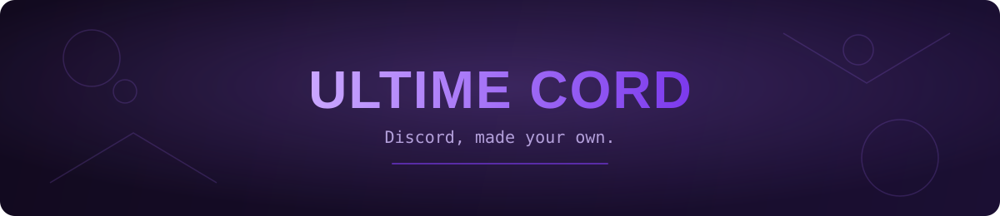
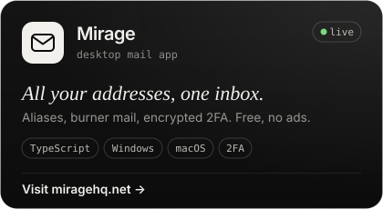
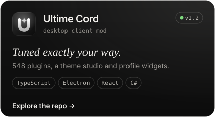
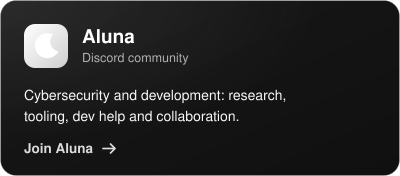

 

  
  
  

 

<table align="center">
  <tr>
    <td width="50%" valign="top">
      <code>// now</code>  
      Polishing <b>Mirage</b>, the mail app. 
      Shipping new plugins for <b>Ultime Cord</b>. 
      Building small tools along the way.
    </td>
    <td width="50%" valign="top">
      <code>// stack</code>  
      <code>TypeScript</code> <code>React</code> <code>Electron</code> 
      <code>Node.js</code> <code>C#</code> <code>Python</code> 
      <code>Vite</code> <code>pnpm</code> <code>Git</code>
    </td>
  </tr>
</table>

 

  
  
  
  

Made by hand, in black and white.

